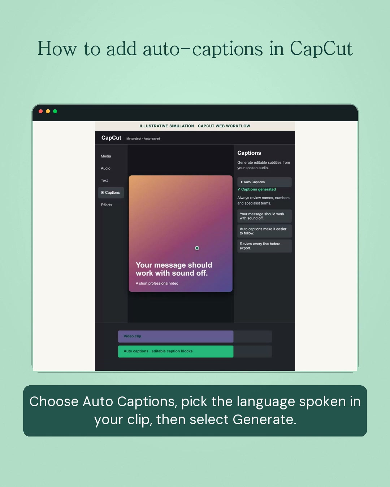

# Her AI Social Reels

An automation pipeline for producing short, branded AI-literacy reels from an approved brief. It turns a guided product demonstration into platform-ready LinkedIn and Instagram videos with narration, captions, safe visual framing, and repeatable brand styling.

Built as a real client workflow—not a mockup—this project demonstrates how I combine browser automation, AI media APIs, Python, and FFmpeg into practical content-production systems.

## Demo

<a href="./docs/demo/capcut-auto-captions-simulation.mp4">
  
</a>

**[Watch the narrated demo →](./docs/demo/capcut-auto-captions-simulation.mp4)**

This is a clearly labelled illustrative simulation of the CapCut auto-captions workflow. It demonstrates the automated narration, simulated interaction, branded layout, and captioning pipeline without exposing a client account or recording.

## What it does

- Creates concise scripts and timing plans for practical AI education.
- Generates English or Dutch narration through ElevenLabs.
- Records approved public website workflows with Playwright, including visible interactions.
- Supports safe client-led capture for login-protected tools and clearly labelled simulated interfaces for repeatable demos.
- Composes separate 1080×1350 LinkedIn and 1080×1920 Instagram exports from the same source.
- Applies a fixed Her AI caption system, branded colours, browser framing, title, and end card.
- Runs a fast preflight check before delivery.

## Automation and quality controls

- Centralised video style tokens, including approved Her AI colour codes.
- Fixed caption typography, positioning, and safe-area clearance from the demo UI.
- `eleven_v4` enforced for narration generation.
- Clean and captioned MP4 delivery pairs.
- Validation of dimensions, runtime, audio presence/level, background token, caption layout, and output files.
- No passwords, cookies, browser profiles, or API keys are stored in source control.

## Workflow

```text
Approved brief
  → script + timing plan
  → narration
  → public / client-led / simulated screen demo
  → branded composition
  → captions
  → preflight validation
  → LinkedIn + Instagram deliverables
```

## Stack

- Python
- Playwright
- ElevenLabs API
- FFmpeg and FFprobe
- Pillow
- HTML/CSS simulations for safe, repeatable tool demonstrations

## Delivery profiles

| Platform | Output | Resolution |
| --- | --- | --- |
| LinkedIn | 4:5 feed video | 1080×1350 |
| Instagram | 9:16 Reel | 1080×1920 |

These are separately composed outputs, not crops of the final video.

## Quick start

1. Copy `.env.example` to `.env` and add client-controlled ElevenLabs credentials.
2. Install dependencies:

   ```bash
   python3 -m pip install requests python-dotenv playwright pillow
   python3 -m playwright install chromium
   brew install ffmpeg
   ```

3. Create a project brief and generate narration:

   ```bash
   python3 scripts/generate_voice.py \
     --script projects/<slug>/script.en.txt \
     --out-dir projects/<slug>/working/narration
   ```

4. Follow the complete production instructions in [SKILL.md](SKILL.md), then run `preflight_reel.py` before delivery.

## Security and client ownership

Credentials remain client-controlled in a local `.env` file, which is ignored by Git. Login-protected recordings are completed only through the client’s legitimate signed-in session, with a clean browser window and an approved demo plan.

## About this build

This is a reusable production-system case study. It recreates a content workflow and visual structure using approved client assets; it does not reuse third-party credentials, proprietary recordings, or unlicensed content.
